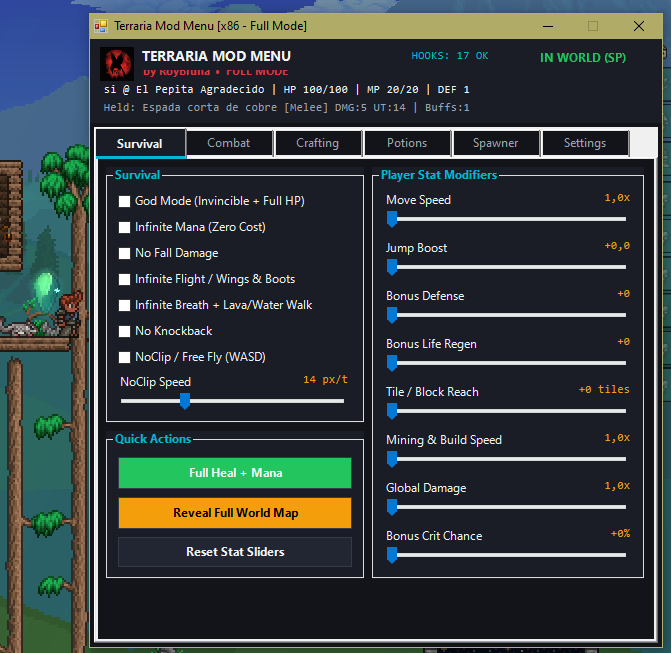
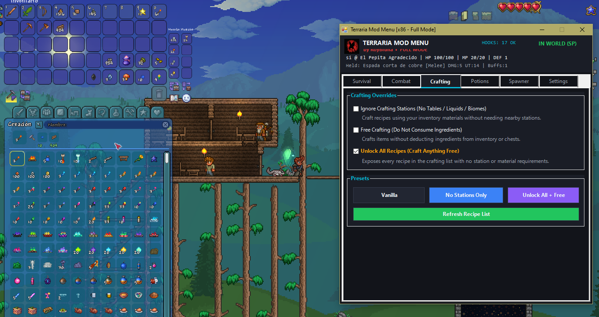
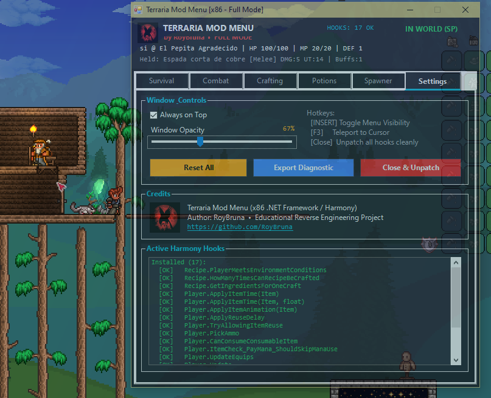

<p align="center">
  
</p>

<h1 align="center">TerraMMod (x86 .NET Runtime Research)</h1>

<p align="center">
  Internal runtime instrumentation, CLR hosting, and WinForms control panel for Terraria Vanilla (1.4.6.x, x86).<br />
  Developed by <a href="https://github.com/RoyBruna">RoyBruna</a> under the GNU General Public License v3.0.
</p>

---

## Overview

This repository is an educational reverse engineering and runtime architecture project created to inspect and experiment with the internal mechanics of **Terraria Vanilla** without tModLoader.

The project explores how a 32-bit .NET Framework XNA application behaves in memory, how native-to-managed CLR bootstrapping operates under x86/WOW64 on Windows, and how Harmony method interception interacts with live game systems (crafting rules, item timers, buff scaling, lighting passes, and map rendering).

During development, an AI engineering assistant was used as a technical aid to inspect binary metadata, verify x86 CLR 4 ABI behavior, locate internal method signatures, and validate complex timing and stat calculations.

---

## Architecture

Because `Terraria.exe` is a 32-bit (`PE32 / Requires32Bit`) .NET Framework process, every project in this solution strictly targets **x86 (`Win32` / `PlatformTarget=x86`)**.

```text
dist/TerrariaModMenu.exe (C++ Win32 / x86)
  |  OpenProcess -> VirtualAllocEx -> WriteProcessMemory -> CreateRemoteThread(LoadLibraryW)
  v
dist/bin/TerrariaModMenu.Bootstrapper.dll (C++ Win32 / x86, static CRT)
  |  CLRCreateInstance -> ICLRMetaHost -> ICLRRuntimeInfo("v4.0.30319")
  |  ICLRRuntimeHost::ExecuteInDefaultAppDomain
  v
dist/bin/TerrariaModMenu.Core.dll (C# .NET Framework 4.8 / x86 + Lib.Harmony 2.2.2)
  |-- SplashForm + MainForm on isolated ApartmentState.STA UI thread
  |-- AssemblyResolve hook for sibling dependencies (0Harmony.dll)
  |-- Game-thread synchronization via Main.OnTickForThirdPartySoftwareOnly
  +-- Modular Harmony patches cleanly unpatched on menu close
```

### Repository Structure

| Path | Description |
| :--- | :--- |
| `src/TerrariaModMenu.Injector/` | Native x86 launcher (`TerrariaModMenu.exe`) with interactive `Full` / `Safe` mode selector and WOW64 validation |
| `src/TerrariaModMenu.Bootstrapper/` | Native C++ CLR host DLL (`KERNEL32.dll` only) binding to Terraria's CLR and invoking `ModEntry.EntryPoint` |
| `src/TerrariaModMenu.Core/` | Managed C# payload (`Core/`, `Patches/`, `UI/`, embedded assets) |
| `assets/` | Project emblem and in-game screenshots |
| `build.ps1` | Single-command MSBuild (Win32) + dotnet build (x86) script outputting into `dist/` |

---

## Launch Modes

Running `dist\TerrariaModMenu.exe` prompts for the execution mode (or accepts `--full` / `--safe` flags):

| Mode | Environment | Behavior |
| :--- | :--- | :--- |
| **Full Mode** (`--full`) | Single-Player (`netMode == 0`) | Installs all 17 Harmony hooks synchronously on the game thread and enables all tabs. Automatically pauses gameplay hooks if `Main.netMode != 0`. |
| **Safe Mode** (`--safe`) | Multiplayer / Read-Only | Installs zero Harmony hooks. Opens the Splash Screen and UI strictly for live telemetry, diagnostics, and read-only inspection. |

---

## Features

1. **Survival**: Native God Mode (`creativeGodMode`), zero-cost Infinite Mana, No Fall Damage, Infinite Flight, Breath/Lava/Water Walk, No Knockback, NoClip WASD movement, instant Full Heal, Reveal Full World Map, and live player stat modifiers (Move Speed, Jump Boost, Defense, Life Regen, Tile Reach, Mining/Build Speed, Global Damage, Crit Chance).
2. **Combat**: Category-separated Rapid Fire (Melee, Ranged, Magic/Summon, Throwables/Explosives, Tools, Blocks) with independent tick sliders, Force Auto-Reuse, Infinite Ammo/Throwables/Blocks, and a live Held Item Inspector and Editor.
3. **Crafting**: Independent overrides for Ignore Crafting Stations, Free Crafting (no ingredient consumption), and Unlock All Recipes, plus quick presets.
4. **Potions**: Infinite buff duration, automatic debuff purge, zero Potion/Mana Sickness, infinite potion stacks, full heal/mana potions, customizable potion power amplifier (`1x` to `20x`), buff packs, and a searchable buff injector.
5. **Spawner & World**: Live searchable Item Spawner (stack and prefix selection), Fullbright (`LightMap.Blur` override), vision flags (Spelunker, Hunter, Dangersense, Night Vision), Full Map Reveal / Clear Map, time controls, enemy spawn rate multiplier (`0x` to `20x`), and Spawn / Cursor teleportation (`F3`).
6. **Settings & Diagnostics**: Always-on-Top toggle, window opacity slider, `INSERT` hotkey to toggle visibility, Credits panel, manual diagnostic report export, and live Harmony hook inspector.

---

## Preview

### Survival & Player Modifiers
<p align="center">
  
</p>

### Crafting Engine Overrides (Unlock All Recipes)
<p align="center">
  
</p>

### Category Rapid Fire
<p align="center">
  
</p>

### Settings, Opacity & Active Harmony Hooks Inspector
<p align="center">
  
</p>

---

## Building from Source

### Requirements

- Windows 10/11 (x64 or x86)
- Visual Studio Build Tools with C++ x86 (`Win32`) toolset
- .NET SDK 8.0+
- Local Terraria Vanilla installation (auto-detected from Steam library folders, or pass `-TerrariaDir`)

### Build & Run

```powershell
.\build.ps1 -Configuration Release
```

To target a different Terraria directory:

```powershell
.\build.ps1 -Configuration Release -TerrariaDir "C:\Program Files (x86)\Steam\steamapps\common\Terraria"
```

1. Launch Terraria Vanilla (`Terraria.exe`).
2. Run `dist\TerrariaModMenu.exe`.
3. Select `[1] Full Mode (Single-Player)` or `[2] Safe Mode (Multiplayer / Read-Only)`.
4. Press `INSERT` to show or hide the window, or click **Close & Unpatch** to cleanly remove all hooks without closing Terraria.

---

## Disclaimer

This software is provided strictly for educational, research, and local single-player experimentation. It is not affiliated with or endorsed by Re-Logic, and contains no copyrighted game binaries or assets. Do not use gameplay modifications on multiplayer servers.

---

## Credits & License

- Author: [RoyBruna](https://github.com/RoyBruna)
- Runtime Patching: [Harmony](https://github.com/pardeike/Harmony) (MIT License)
- License: [GNU General Public License v3.0](LICENSE)
